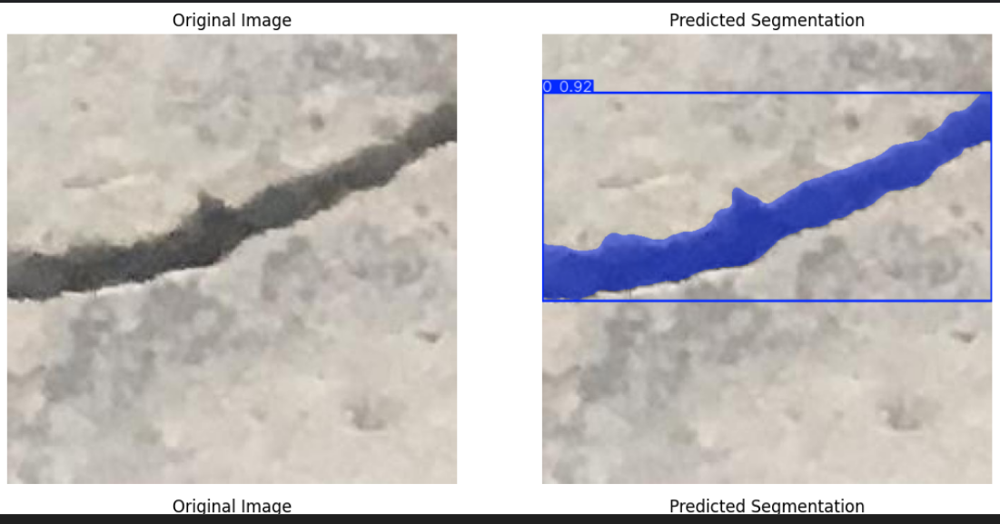
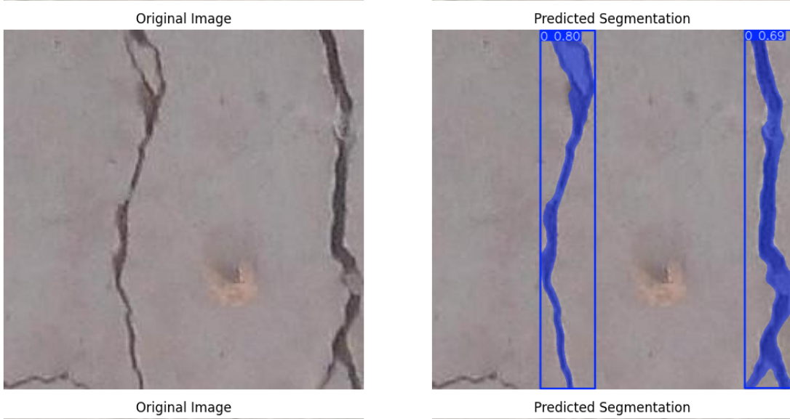
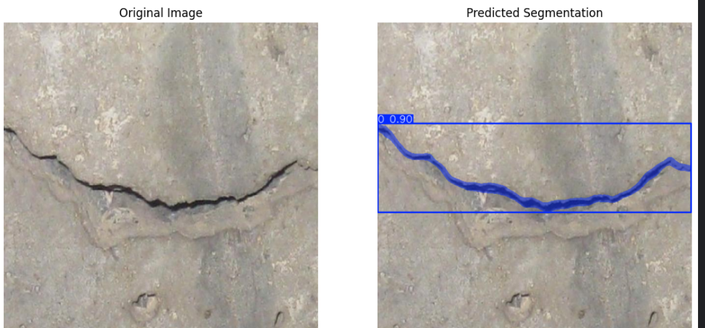

# Crack Segmentation AI — YOLO11s

Surface crack detection and **instance segmentation** using a fine-tuned **YOLO11s-seg** model, with a Streamlit interface for uploading images, visualizing predicted masks, and downloading annotated predictions.

## Demo predictions

Place `pred1.png`, `pred2.png`, and `pred3.png` in the project root so these images display on GitHub.







## Dataset

- **Source:** [Roboflow — Crack Sort, Version 3](https://universe.roboflow.com/crack-dataset-p78qp/crack-sort-ybxie/dataset/3)
- **License:** CC BY 4.0 (as specified in the dataset YAML)
- **Task:** Single-class crack instance segmentation using polygon annotations
- **Training:** 24,260 images; 26,424 polygon annotations counted in the notebook
- **Validation:** 2,627 images; 2,817 instances reported during training
- **Test:** 2,619 images; 2,802 instances reported during evaluation

## Training configuration

| Setting | Notebook value |
|---|---|
| Base weights | `yolo11s-seg.pt` |
| Framework | Ultralytics YOLO |
| Image size | 640 |
| Max epochs | 100 |
| Batch size | 16 |
| Early stopping patience | 10 |
| Optimizer | AdamW |
| Initial learning rate | 0.001 |
| Cosine LR schedule | Enabled |
| Random seed | 42 |
| Training environment | Kaggle GPU (CUDA) |

The notebook's recorded training log reaches epoch 23 in the visible run; its `results.csv` output contains 22 completed epochs. The configured 100 epochs should not be interpreted as 100 completed epochs.

## Test set evaluation

The following results are taken from the notebook's **test split** evaluation of `best.pt` at image size 640:

| Metric | Bounding boxes | Segmentation masks |
|---|---:|---:|
| Precision | 0.9307 | 0.8196 |
| Recall | 0.8758 | 0.7659 |
| F1-score | 0.9024 | 0.7918 |
| mAP@50 | 0.9292 | 0.7920 |
| mAP@50:95 | 0.7845 | 0.5011 |

The evaluation used 2,619 test images and 2,802 annotated instances. These are notebook-reported measurements, not results re-run by this repository template.

## Project structure

```text
crack-segmentation/
├── app.py
├── requirements.txt
├── README.md
├── models/
│   └── best.pt
├── pred1.png
├── pred2.png
└── pred3.png
```

## Run locally

1. Put your trained YOLO segmentation weights at `models/best.pt`.
2. Install dependencies:

   ```bash
   pip install -r requirements.txt
   ```

3. Launch Streamlit:

   ```bash
   streamlit run app.py
   ```

4. Upload a JPG or PNG, adjust confidence and image size, and click **Run segmentation**. Download the annotated result as PNG.

## Notes

- The app runs on CPU by default if CUDA is unavailable; Ultralytics can use a compatible GPU automatically when configured in the environment.
- Instance counts represent predicted crack objects, not crack length, severity, or pixel-level coverage.
- For thin cracks, visually inspect masks in addition to relying on aggregate mAP metrics.
- The three demo image files and the trained weights are **not embedded** in this project package; add your actual files before publishing.

## Acknowledgments

Dataset sourced from Roboflow Universe, Crack Sort v3 (CC BY 4.0). Training and evaluation details were extracted from the supplied Kaggle notebook `crack-segmentation.ipynb`.
